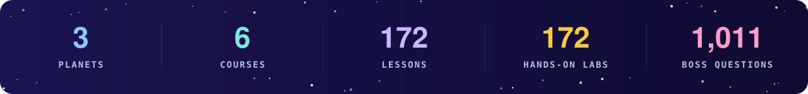
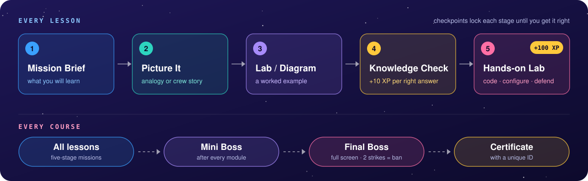
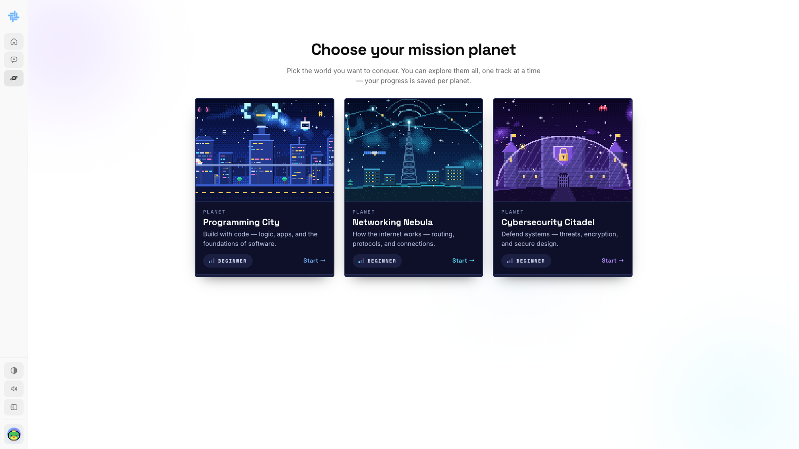
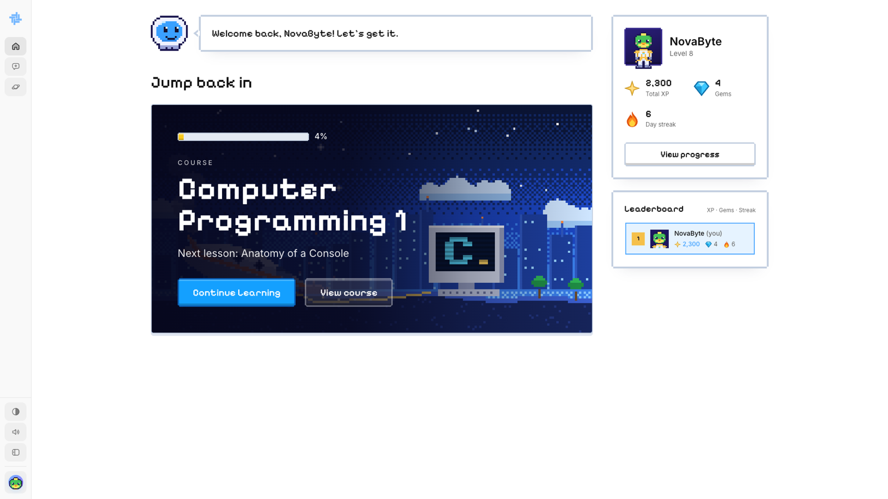
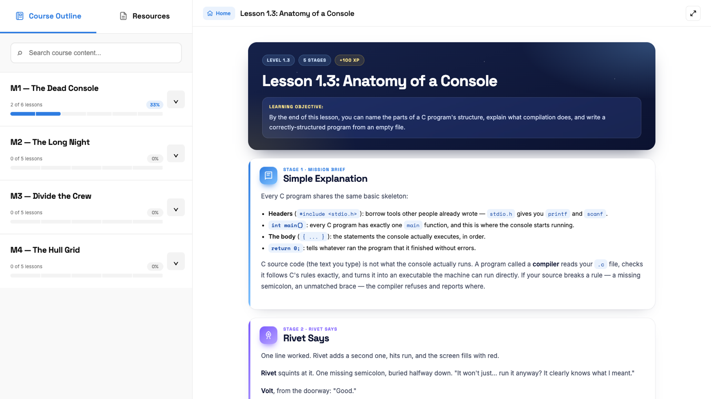
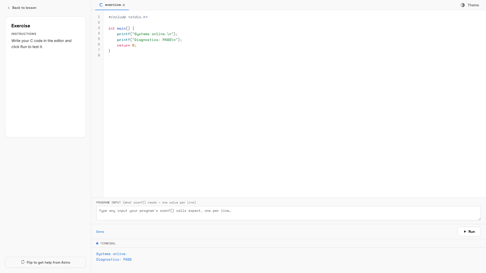
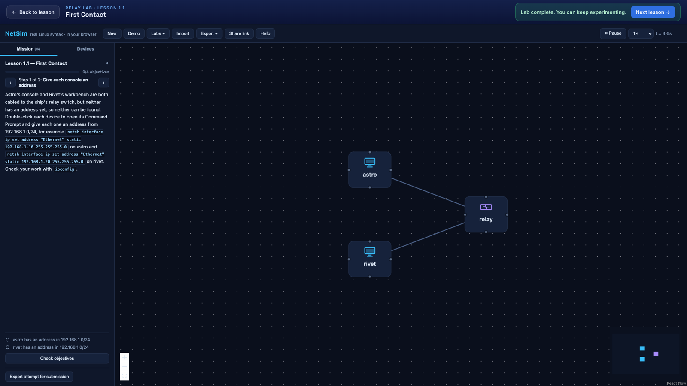
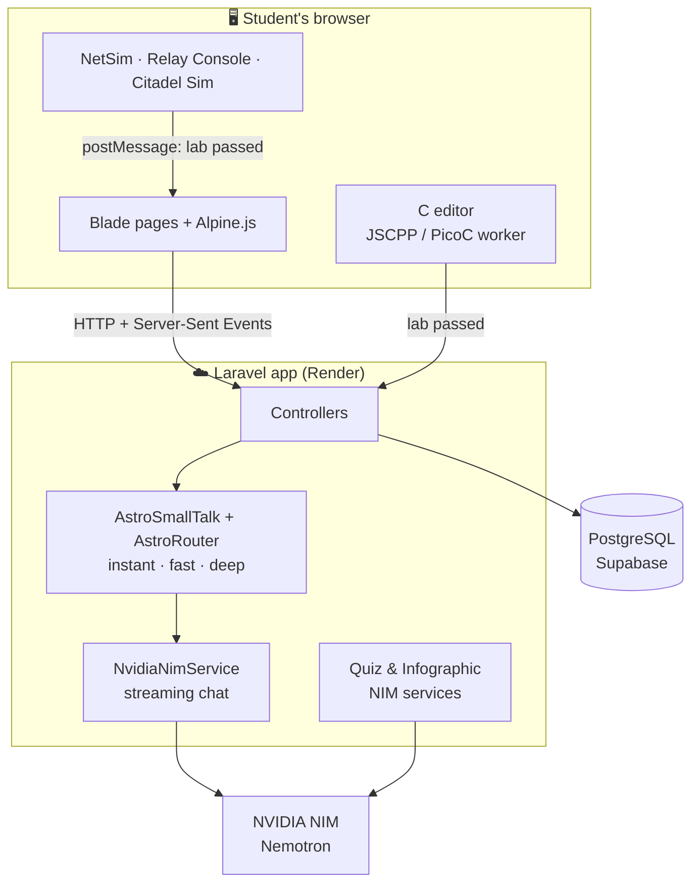
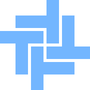

<p align="center">
  
</p>

<p align="center">
  
  
  
  
  
  
</p>

<p align="center">
  <a href="#-what-is-techlab">About</a> &nbsp;•&nbsp;
  <a href="#-the-three-planets">Planets</a> &nbsp;•&nbsp;
  <a href="#-features">Features</a> &nbsp;•&nbsp;
  <a href="#-screenshots">Screenshots</a> &nbsp;•&nbsp;
  <a href="#-tech-stack">Tech stack</a> &nbsp;•&nbsp;
  <a href="#-getting-started">Getting started</a> &nbsp;•&nbsp;
  <a href="#-testing">Testing</a>
</p>

<br>

## 🚀 What is TechLab?

**TechLab** is a gamified learning platform that teaches **programming, networking and cybersecurity** to college IT students. Every subject is a planet, every course is a story season, and every lesson ends with something you actually *do*: write C code, wire up a network, or defend a hacked server.

Students are **astronauts**. Their guide is **Astro**, a friendly AI teacher who explains things in plain words, at any hour. Faculty are **Captains** who run their own classes, and admins keep the whole fleet on course.

> [!NOTE]
> **No installs, no lab rooms.** C programs, Cisco-style routers and a fake Linux server all run *inside the student's browser*, so a phone hotspot and a laptop are enough to do real hands-on work.

<p align="center">
  
</p>

<br>

## 🪐 The three planets

<table>
  <tr>
    <td width="33%" valign="top">
      
      <h3>Programming City</h3>
      <p>Learn C from zero: variables, decisions, functions, arrays, then structs, pointers, <code>malloc</code> and files.</p>
      <p>💻 <b>Code it yourself</b> in a built-in C editor.</p>
    </td>
    <td width="33%" valign="top">
      
      <h3>Networking Nebula</h3>
      <p>How the internet works: addressing, switching, routing, then VLANs, OSPF, HSRP, ACLs, BGP, QoS and VPNs.</p>
      <p>🛰️ <b>Configure it yourself</b> on simulated Cisco IOS gear.</p>
    </td>
    <td width="33%" valign="top">
      
      <h3>Cybersecurity Citadel</h3>
      <p>Threats, accounts, permissions, logs, hashing and incident response, told as a siege on the Citadel.</p>
      <p>🛡️ <b>Defend it yourself</b> on a simulated Linux server.</p>
    </td>
  </tr>
</table>

| Planet | Course | Modules · Lessons | Hands-on lab | Story season |
|:--|:--|:--:|:--|:--|
| 🏙️ Programming City | Computer Programming 1 | 4 · 21 | C editor (JSCPP) | *The Dead Console* |
| 🏙️ Programming City | Computer Programming 2 | 6 · 31 | C editor (PicoC) | *Switch the City On* |
| 🌌 Networking Nebula | Networking 1 | 4 · 24 | NetSim | *Call Earth* |
| 🌌 Networking Nebula | Networking 2 | 6 · 32 | NetSim (Cisco IOS) + Relay Console | *Light the Grid* |
| 🏰 Cybersecurity Citadel | Information Assurance & Security 1 | 5 · 24 | Citadel Sim + NetSim | *Siege of the Citadel* |
| 🏰 Cybersecurity Citadel | Information Assurance & Security 2 | 8 · 40 | Citadel Sim | *Rebuilding the Citadel* |

<br>

## ✨ Features

<table>
  <tr>
    <td width="50%" valign="top">
      <h3>🤖 Astro, the AI teacher</h3>
      A chat tutor powered by <b>NVIDIA NIM (Nemotron)</b> that streams answers word by word. Students can attach unlocked lessons, files and photos as sources, or talk by voice. Astro picks its effort per message: small talk is answered instantly, simple questions get a fast reply, and debugging or "explain step by step" questions get deep thinking.
    </td>
    <td width="50%" valign="top">
      <h3>🧪 Labs that run in the browser</h3>
      <b>NetSim</b> for network topologies with a real Cisco IOS console, <b>Relay Console</b> for router command-line work, <b>Citadel Sim</b> for a fake Linux machine (<code>grep</code>, pipes, <code>sudo</code>, <code>ss</code>, <code>setfacl</code>…), and C running in a Web Worker. No server ever executes student code.
    </td>
  </tr>
  <tr>
    <td width="50%" valign="top">
      <h3>🎮 A real game loop</h3>
      XP for every lesson, gems for every module, daily streaks, <b>11 space ranks</b> from Stardust to Galaxy Legend, 33 avatar frames, a Shop for animal astronauts and suits, and crew and planet leaderboards.
    </td>
    <td width="50%" valign="top">
      <h3>⚔️ Mini bosses & the Final Boss</h3>
      A full-screen exam closes every module, and a Final Boss closes every course. Leaving full screen or switching tabs is an instant fail, two strikes is a ban, and passing earns a certificate with a unique ID.
    </td>
  </tr>
  <tr>
    <td width="50%" valign="top">
      <h3>🧭 Self-paced or Join Class</h3>
      Every course has two ways in. <b>Self-paced</b> follows the default course with prerequisites. <b>Join Class</b> puts the student in a faculty member's class, with that Captain's own edits and signature on the certificate.
    </td>
    <td width="50%" valign="top">
      <h3>🛠️ Built for teachers too</h3>
      Captains edit lessons, quizzes, labs and exams in place (changes reach only their class), build brand-new courses from scratch, upload materials, accept students and watch analytics. A lab only saves if its answer key still passes.
    </td>
  </tr>
</table>

### 📚 How a lesson works

Every lesson is the same five-stage mission, and every course builds up to a boss fight.

<p align="center">
  
</p>

### 👥 Three roles

| | Who | What they do |
|:--|:--|:--|
| 🧑‍🚀 **Astronaut** | Student | Builds an avatar, picks a planet, learns, earns XP, chats with Astro, fights bosses |
| 🧑‍✈️ **Captain** | Faculty | Opens classes, accepts students, edits or builds courses, writes exams, tracks progress |
| 🛰️ **Admin** | Staff | Assigns faculty to courses, watches self-paced learners, manages finals and admins |

<br>

## 📸 Screenshots

<p align="center">
  
  <br><sub><b>Choose your mission planet</b></sub>
</p>

<table>
  <tr>
    <td width="50%" align="center">
      
      <br><sub><b>Home</b>: jump back in, XP, gems, streak, leaderboard</sub>
    </td>
    <td width="50%" align="center">
      
      <br><sub><b>Lesson</b>: a five-stage mission with a story</sub>
    </td>
  </tr>
  <tr>
    <td width="50%" align="center">
      
      <br><sub><b>Code it yourself</b>: C runs right in the browser</sub>
    </td>
    <td width="50%" align="center">
      
      <br><sub><b>Configure it yourself</b>: a NetSim lab</sub>
    </td>
  </tr>
</table>

<br>

## 🧰 Tech stack

| Layer | Technology |
|:--|:--|
| **Backend** | Laravel 13 (PHP 8.3+) |
| **Frontend** | Server-rendered Blade + Alpine.js + Tailwind CSS, built with Vite. React only for isolated widgets |
| **Database** | PostgreSQL on Supabase (tests use in-memory SQLite) |
| **AI** | NVIDIA NIM: Nemotron 3 Ultra for Astro, Llama 3.2 Vision for reading images |
| **C&nbsp;runtimes** | [JSCPP](https://github.com/felixhao28/JSCPP) (Programming 1) and PicoC compiled for the browser (Programming 2), in Web Workers |
| **Simulators** | NetSim (React + React Flow, Cisco IOS engine with 802.1Q, STP, OSPF, HSRP/VRRP, ACLs), Relay Console and Citadel Sim (plain ES modules) |
| **Hosting** | Docker (PHP 8.4 + Apache) on Render, defined in [`render.yaml`](render.yaml) |

### 🏗️ Architecture at a glance



- **Course content is code, not data.** Lessons are Blade files under `resources/views/student/planets/`, and [`config/course-structure.php`](config/course-structure.php) maps every course, module and lesson.
- **Faculty edits are layered on top.** A Captain's changes live in the database, keyed by their class, so the default course always stays intact.
- **Each AI feature has its own service and config** (`NvidiaNimService`, `QuizNimService`, `InfographicNimService`), so tuning one never breaks another.

<br>

## ⚡ Getting started

**You'll need:** PHP 8.3+, Composer, Node.js 20+, and an [NVIDIA NIM API key](https://build.nvidia.com) for Astro.

```bash
# 1. Clone
git clone https://github.com/keyan318/techlab.git
cd techlab

# 2. Install everything, create .env, generate the app key, migrate, build assets
composer run setup

# 3. Add your AI key to .env
#    NVIDIA_NIM_API_KEY=your-key
#    NVIDIA_NIM_MODEL=nvidia/nemotron-3-ultra-550b-a55b

# 4. Create the first admin account (it asks for a password)
php artisan admin:create you@example.com --name="Your Name"

# 5. Launch: app server, queue worker, logs and Vite, all at once
composer run dev
```

Then open **http://localhost:8000** and start your mission. 🚀

> [!TIP]
> Out of the box, `.env.example` uses **SQLite**, so you don't need a database server to try TechLab locally. Production uses PostgreSQL (see [`render.yaml`](render.yaml)).

<details>
<summary><b>🔧 Building the simulators</b></summary>
<br>

Citadel Sim and Relay Console are plain ES modules served straight from `public/`, so they need no build. NetSim is a separate Vite app:

```bash
cd resources/netsim-app
npm install
npm run build    # copies labs into public/netsim-app/
```

Programming 2's PicoC runtime is rebuilt with `node scripts/build-picoc.mjs`.

</details>

<br>

## 🧪 Testing

```bash
php artisan test                                   # Laravel suite (in-memory SQLite, no setup needed)
php artisan test --filter=AstroSmallTalkTest       # one test class

node --test tests/citadel-sim/engine.test.mjs      # Citadel Sim engine; plays every lab to the end
node --test "tests/relay-console/*.test.mjs"       # Relay Console labs vs. their scripted solutions
node --test "tests/picoc/*.test.mjs"               # every Programming 2 answer key runs under PicoC
(cd resources/netsim-app && npm test)              # NetSim engine + every Networking 2 lab solution

./vendor/bin/pint                                  # code style
```

<br>

## 🗂️ Project structure

```text
techlab/
├── app/
│   ├── Http/Controllers/        # PlanetController, ChatController, LessonLabController, exams…
│   └── Services/                # Astro (NIM, router, small talk), mini bosses, finals, XP, ranks
├── config/
│   ├── course-structure.php     # course → module → lesson blueprint
│   └── nvidia_nim.php           # Astro's model, modes and system prompt
├── resources/
│   ├── views/student/planets/   # every lesson, one Blade file each
│   ├── mini-bosses/             # 1,011 default mini-boss questions (JSON)
│   └── netsim-app/              # NetSim source (React + TypeScript)
├── public/
│   ├── citadel-sim/             # Citadel Sim + its labs
│   └── relay-console/           # Relay Console + its labs
├── tests/                       # PHPUnit + Node test suites
├── Dockerfile · render.yaml     # production image and Render blueprint
└── docs/                        # system overview, storyboards, user manual
```

<br>

---

<p align="center">
  
  <br>
  <b>TechLab</b>: built for CICT students at CatSU.
  <br>
  <sub>Learn to code, connect and defend, one planet at a time.</sub>
</p>
